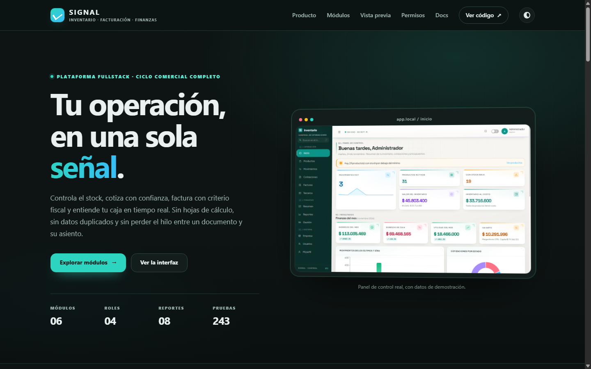
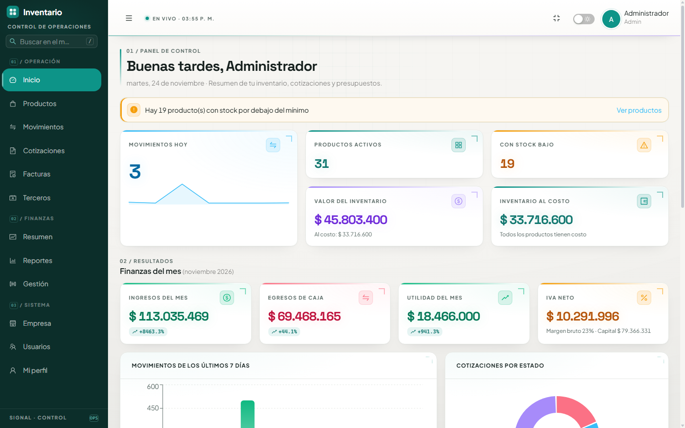
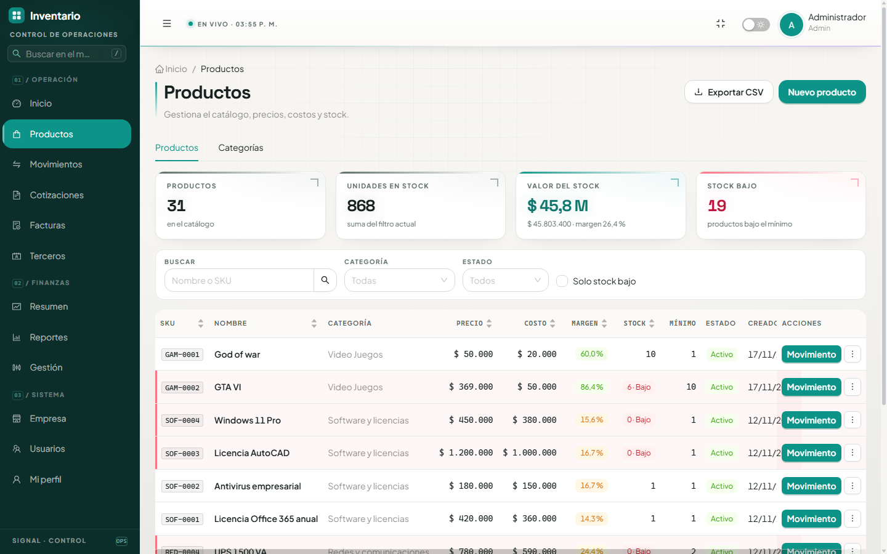
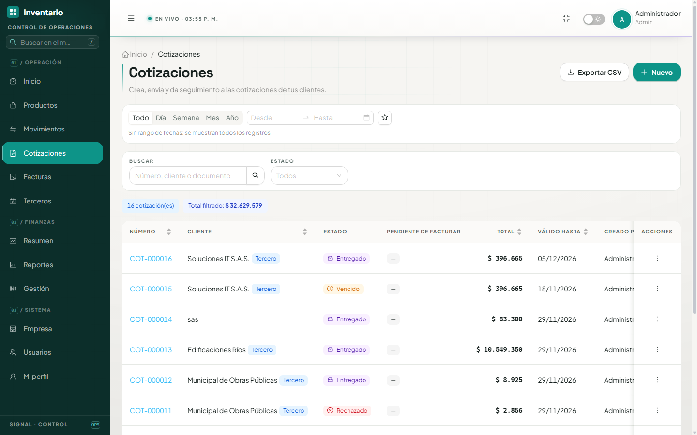
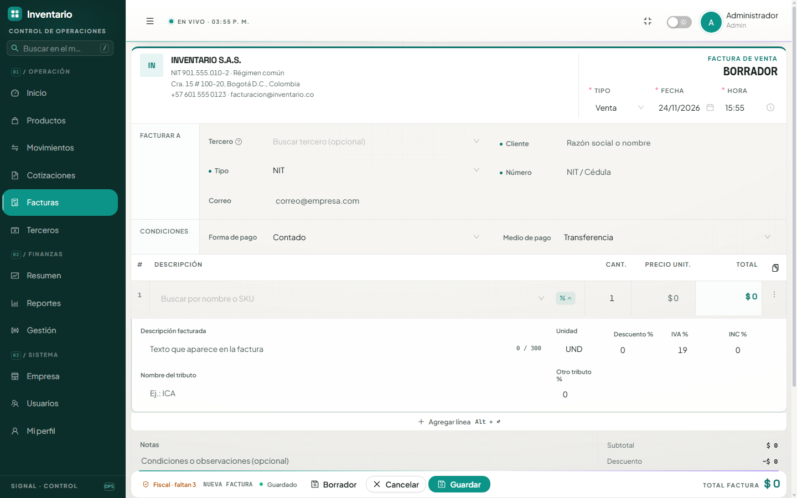
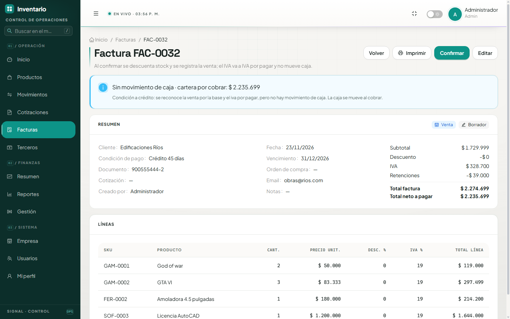
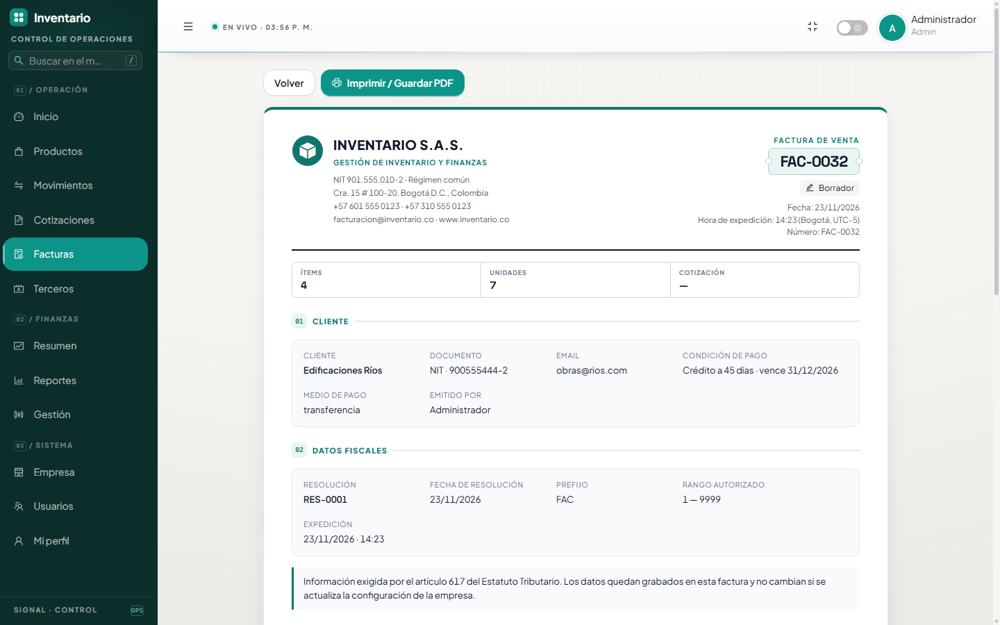
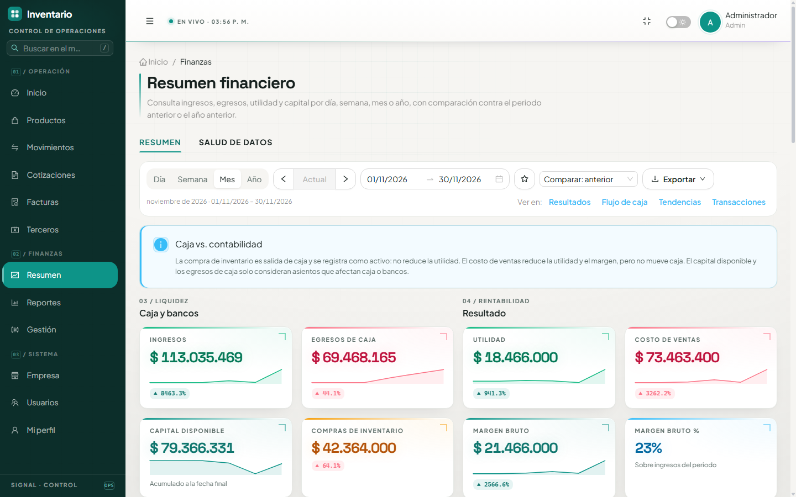
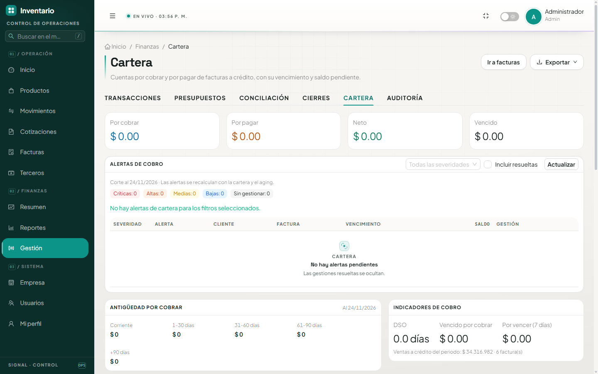
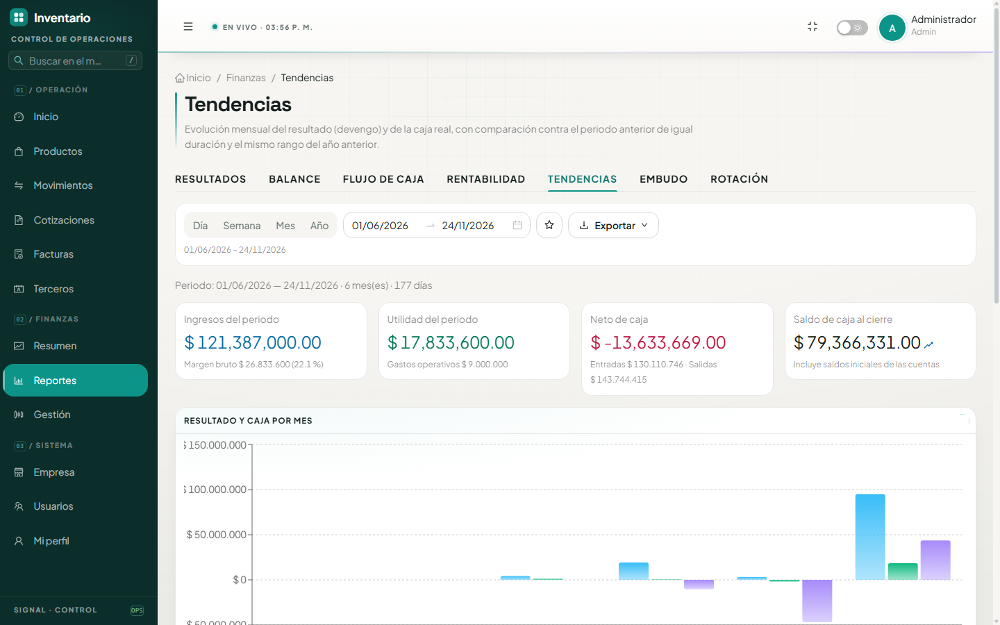

# Sistema de Inventario, Facturación y Finanzas

[](https://edisonmonsalve.github.io/aplicacion-prueba/)

*Portada pública del proyecto — haz clic para abrir la landing en
[edisonmonsalve.github.io/aplicacion-prueba](https://edisonmonsalve.github.io/aplicacion-prueba/).*

Aplicación web fullstack para gestionar el ciclo comercial completo de una empresa: catálogo y
stock, cotizaciones, facturas de venta y compra, cartera cobrable/pagable, contabilidad analítica
y reportes. El proyecto sirve además como práctica de CRUD completo, reglas de negocio,
transacciones SQL, cálculos monetarios y máquinas de estado.

La interfaz sigue el sistema visual **Signal**: panel de control con tipografía técnica,
KPIs con semántica contable, tema claro/oscuro y superficies flotantes con vidrio quirúrgico.
La cotización es una propuesta comercial y **no contabiliza**; la factura es el documento que
mueve stock y genera asientos.

> Datos de demostración disponibles con `npm run seed:demo`. Usuario admin:
> `demo@demo.com` / `Demo1234!`.

## Índice

- [Vista previa](#vista-previa)
- [Módulos](#módulos)
- [Acceso y roles](#acceso-y-roles)
- [Reglas de negocio](#reglas-de-negocio)
- [Stack](#stack)
- [Puesta en marcha](#puesta-en-marcha)
- [Scripts](#scripts)
- [API](#api)
- [Pruebas y calidad](#pruebas-y-calidad)
- [Decisiones técnicas](#decisiones-técnicas)
- [Estructura del proyecto](#estructura-del-proyecto)
- [Documentación](#documentación)
- [Posibles mejoras](#posibles-mejoras)
- [Autor](#autor)

## Vista previa

Capturas reales de la aplicación con datos demo, a 1440 × 900 px. La portada pública se muestra
al inicio de este documento.

| Inicio | Productos |
| :---: | :---: |
|  |  |
| **Inicio** — KPIs, alertas de stock y actividad reciente. | **Productos** — búsqueda, filtros, stock y acciones por fila. |

| Cotizaciones | Formulario de factura |
| :---: | :---: |
|  |  |
| **Cotizaciones** — estados, vencimiento y generación de factura. | **Factura** — líneas con IVA, descuento y detalle fiscal. |

| Detalle de factura | Impresión fiscal |
| :---: | :---: |
|  |  |
| **Detalle** — totales, retenciones, cotización y asientos. | **Impresión** — documento listo para guardar como PDF. |

| Resumen financiero | Cartera | Tendencias |
| :---: | :---: | :---: |
|  |  |  |
| **Finanzas** — caja, utilidad, IVA y cuentas. | **Cartera** — aging, saldos y alertas de cobro. | **Tendencias** — evolución por periodo. |

## Módulos

### Inventario

- Categorías, productos y movimientos de stock con paginación y filtros en servidor.
- Alertas de stock bajo y sugerencia de SKU en el formulario.
- Entradas y salidas transaccionales; el historial guarda costo histórico, precio de venta,
  origen y enlace al documento que originó el movimiento.
- Costos y márgenes visibles para `admin`, `contador` y `consulta`; el `operador` los ve como
  `null`. Solo `admin` fija el costo de referencia de un producto.

### Cotizaciones

- Líneas dinámicas con precio del catálogo, descuento por línea e IVA.
- Estados: `borrador → enviado → aprobado → entregado`, o `enviado → rechazado`. El estado
  **vencido** se calcula al pasar la fecha de validez.
- Duplicado, auditoría de ediciones, historial de estados e impresión / PDF.
- Facturación por hitos: una cotización puede tener varias facturas vinculadas. La factura
  refleja el valor real de la venta, aunque difiera de lo cotizado.
- Al confirmar una factura de venta vinculada, la cotización pasa a `entregado` y el stock se
  mueve una sola vez. El endpoint de entrega de almacén se conserva para una mejora posterior.

### Facturación

- Facturas de **venta** (`FAC-`) y **compra** (`COM-`) con numeración consecutiva segura.
- Estados: `borrador → confirmada → anulada`. Solo se editan o eliminan borradores.
- Cabecera con cuenta de caja/banco, orden de compra, email, notas, descuentos, IVA y
  retenciones de fuente, IVA e ICA.
- La confirmación mueve stock y crea asientos de cabecera por factura: ingreso neto, IVA por
  pagar y costo de ventas en ventas; activo Inventario e IVA descontable en compras.
- Una venta a crédito genera cuenta por cobrar; una compra a crédito, cuenta por pagar. El IVA
  y las retenciones no mueven caja.
- Notas crédito/débito sobre facturas confirmadas y anulación con contrapartidas.
- Vista de impresión fiscal con identidad de empresa configurable.

### Cartera y cobros

- Cartera derivada de facturas confirmadas, con aging, saldos y principales deudores.
- Alertas por mora: crítica (> 90 días), alta (31–90), media (1–30 o sin vencimiento) y baja
  (vence en los próximos 7 días).
- Registro de cobros/pagos y anulación de pagos con contrapartida.
- Seguimiento comercial de alertas: pendiente, recordado, promesa de pago, escalado o resuelto.
  No modifica la factura ni la contabilidad.

### Finanzas y reportes

- Cuentas con saldo inicial, presupuestos por periodo y transacciones inmutables que se anulan
  con contrapartidas.
- Presupuestos con líneas de alcance general, por producto o por categoría de producto, con
  ejecución real, disponible, proyección y alertas.
- Reportes de resultados, flujo de caja, balance, rentabilidad, rotación de inventario, embudo
  de cotizaciones, tendencias y salud de datos.
- Conciliación bancaria con sugerencias por importe y tolerancia de fechas; no crea ni modifica
  asientos.
- Cierres de periodo y de ejercicio con snapshots inmutables y reapertura auditada.
- Visor de auditoría y exportación CSV/PDF que respeta los filtros activos.

### Empresa y perfil

- Configuración de la identidad del emisor para documentos impresos (solo administrador).
- Perfil con cambio de contraseña y selector de tema claro/oscuro.

## Acceso y roles

| Rol | Inventario | Cotizaciones | Facturas | Cartera | Finanzas | Usuarios / Empresa |
| --- | --- | --- | --- | --- | --- | --- |
| `admin` | Completo | Completo | Completo | Completo | Completo | Gestión |
| `contador` | Lectura | Lectura | Crear, confirmar y anular | Cobros, pagos, notas y seguimiento | Completo | Lectura de Empresa |
| `operador` | Operación | Operación | Crear y confirmar | — | Sin acceso | — |
| `consulta` | Lectura | Lectura | Lectura | Lectura | Solo lectura | — |

Usuarios demo creados por `seed:demo` (todos con clave `Demo1234!`):

| Correo | Rol |
| --- | --- |
| `demo@demo.com` | admin |
| `contador@demo.com` | contador |
| `operador@demo.com` | operador |
| `consulta@demo.com` | consulta |

## Reglas de negocio

### Inventario

- **RN-01:** el SKU de un producto es único.
- **RN-02:** no se permite una salida mayor al stock disponible.
- **RN-03:** el stock solo cambia mediante movimientos, y el movimiento y su actualización de
  stock ocurren en una única transacción con bloqueo de fila.
- **RN-04:** los productos no se eliminan, se desactivan.
- **RN-05:** una categoría con productos asociados no se puede eliminar.
- **RN-06:** un usuario no puede desactivarse a sí mismo ni quitarse el rol de admin.
- **RN-07:** precios y cantidades deben ser mayores que cero.
- **RN-08:** solo `admin` fija `products.costo` y el costo de una entrada; el `operador` crea
  productos con costo 0. Las salidas guardan el costo histórico del momento.
- **RN-09:** el `operador` recibe los costos como `null`; `contador` y `consulta` los ven en
  solo lectura.

### Cotizaciones

- **RN-P01:** solo los borradores se editan o eliminan; un presupuesto enviado es inmutable.
- **RN-P02:** cada línea guarda una copia de SKU, nombre y precio al cotizar.
- **RN-P03:** solo productos activos, cantidad entera mayor que cero y sin repetir producto.
- **RN-P04:** descuento de 0 a 100 %; el operador aplica hasta 10 %.
- **RN-P05:** los totales los calcula siempre el servidor, con redondeo a 2 decimales.
- **RN-P06:** un presupuesto enviado vence al pasar su fecha de validez y ya no puede aprobarse.
- **RN-P07:** cotizar no reserva stock.
- **RN-P08:** la salida de stock ocurre al confirmar la factura de venta; si la cotización ya
  estaba entregada, se concilian cantidades en lugar de mover el stock dos veces.
- **RN-P09:** los movimientos por documento quedan trazables y se crean en una transacción,
  bloqueando productos en orden de id para evitar interbloqueos.
- **RN-P10:** se necesita al menos una línea para enviar.
- **RN-P11:** la fecha de validez no puede ser anterior a hoy.
- **RN-P12:** cada cambio de estado queda registrado con usuario y fecha.
- **RN-P13:** el operador solo ve y duplica sus propias cotizaciones.
- **RN-P14:** el número documental usa el prefijo `COT-`.

### Facturación, cartera y finanzas

- **RN-F01:** la numeración `FAC-`/`COM-` usa `invoice_counters` con `FOR UPDATE`.
- **RN-F02:** solo se editan borradores; se anulan solo facturas confirmadas y sin pagos válidos.
- **RN-F03:** una venta descuenta stock y contabiliza; una compra suma stock como activo y no
  modifica el costo de referencia del producto.
- **RN-F04:** a crédito, la factura genera cartera por `total_neto` y no mueve caja hasta el
  cobro o pago. El IVA nunca forma parte del movimiento de caja.
- **RN-F05:** las retenciones reducen el neto y se reconocen como activo o pasivo, sin generar
  asientos de caja.
- **RN-F06:** un cobro o pago no puede superar el saldo pendiente; al anularse genera una
  contrapartida y nunca se borra.
- **RN-F07:** las alertas de cartera se derivan del aging; el seguimiento es solo gestión
  comercial y queda en auditoría.
- **RN-F08:** las transacciones no se editan ni se borran: se anulan con una contrapartida. Los
  asientos automáticos se anulan desde su factura.
- **RN-F09:** los cierres congelan snapshots y bloquean asientos del periodo; la conciliación
  no modifica la contabilidad.
- **RN-F10:** los reportes respetan los filtros de pantalla: el CSV conserva valores numéricos y
  el PDF es una vista imprimible.

## Stack

| Capa | Tecnología |
| --- | --- |
| Frontend | React 19, TypeScript 5.9, Vite 8, Ant Design 6, React Router 7, Axios, Recharts, Zod |
| Backend | Node.js, Express 5, TypeScript, Zod |
| Base de datos | MariaDB (driver `mysql2`) con migraciones numeradas |
| Seguridad | JWT, bcryptjs, middleware de roles y DTO sensibles al rol |
| Pruebas y calidad | Vitest, Supertest, ESLint, `tsc --noEmit` |

## Puesta en marcha

### Requisitos previos

- Node.js 22 recomendado (Vite 8 requiere 20.19+ o 22.12+).
- MariaDB 10.5 o superior.

### 1. Base de datos y backend

```bash
cd server
npm install
cp .env.example .env     # en Windows: copy .env.example .env
npm run migrate          # crea la base si no existe y aplica migraciones pendientes
```

Si ya tenías una base con el esquema anterior, adóptala con
`npm run migrate -- --baseline=1`.

| Variable | Descripción |
| --- | --- |
| `PORT` | Puerto de la API (por defecto `3000`) |
| `DB_HOST`, `DB_PORT` | Servidor de MariaDB |
| `DB_USER`, `DB_PASSWORD` | Credenciales de la base |
| `DB_NAME` | Nombre de la base (`inventario`) |
| `JWT_SECRET` | Cadena larga y aleatoria para firmar los tokens |

Crea el primer administrador y arranca la API:

```bash
npm run seed:admin -- admin@ejemplo.com TuClaveSegura123
npm run dev
```

La API queda en `http://localhost:3000`. Comprueba su estado en
`http://localhost:3000/api/health`.

Para dejar la base de desarrollo limpia con datos de ejemplo:

```powershell
# 1. Detén el servidor y borra/recrea la base (pide confirmación explícita)
$env:RESET_DEV_DB='si'; npm run reset:dev

# 2. Crea el administrador demo
npm run seed:admin -- demo@demo.com "Demo1234!"

# 3. Inicia el servidor
npm run dev

# 4. En otra terminal, siembra datos demo
npm run seed:demo
```

> `reset:dev` solo funciona si `DB_NAME` no termina en `_test` y no es una base del sistema.
> El seed demo es idempotente por secciones: no duplica movimientos, transacciones ni
> cotizaciones. Crea **Caja principal** (3.000.000) y **Banco principal** (25.000.000).

### 2. Frontend

```bash
cd client
npm install
npm run dev
```

La aplicación queda en `http://localhost:5173`. Vite redirige `/api` al backend, así que no
hace falta configurar CORS en desarrollo.

## Scripts

| Carpeta | Comando | Descripción |
| --- | --- | --- |
| `server` | `npm run dev` | Servidor con recarga automática |
| `server` | `npm run build` | Compila TypeScript a `dist/` |
| `server` | `npm start` | Ejecuta la versión compilada |
| `server` | `npm run typecheck` | Verifica tipos sin compilar |
| `server` | `npm run lint` | Revisa el código con ESLint |
| `server` | `npm test` | Ejecuta las pruebas |
| `server` | `npm run test:watch` | Pruebas en modo observador |
| `server` | `npm run test:db` | Crea/actualiza la base de pruebas |
| `server` | `npm run migrate` | Aplica las migraciones pendientes |
| `server` | `npm run seed:admin -- correo clave` | Crea un usuario administrador |
| `server` | `npm run seed:demo` | Siembra datos demo (requiere el servidor activo) |
| `server` | `npm run reset:dev` | Borra y recrea la base de desarrollo |
| `server` | `npm run openapi:export` | Regenera la spec y el contrato TS del cliente |
| `client` | `npm run dev` | Servidor de desarrollo |
| `client` | `npm run build` | Verifica tipos y genera el build |
| `client` | `npm run preview` | Sirve el build generado |
| `client` | `npm run lint` | Revisa el código con ESLint |

## API

Todas las rutas, salvo el login y `health`, requieren `Authorization: Bearer <token>`.
Los errores siguen un formato único: `{ "message": "..." }`, más `errors` cuando hay detalle
(validación Zod o líneas sin stock), con códigos 400, 401, 403, 404, 409 y 500.

**Referencia completa y ejecutable:** con el servidor en marcha abre
`http://localhost:3000/api/docs` (Swagger UI). El JSON OpenAPI 3.1 está en
`/api/openapi.json` y una copia versionada en [`docs/api/openapi.json`](docs/api/openapi.json).

La spec **no se escribe a mano**: las rutas se leen del router real de Express y los esquemas de
petición se generan con `z.toJSONSchema` desde los mismos esquemas Zod que validan cada
petición. Las tablas de abajo son un resumen humano; si una ruta nueva aparece sin metadata,
la spec la documenta igualmente con un resumen genérico. El contrato TypeScript del cliente
([`api-contract.generated.ts`](client/src/services/api-contract.generated.ts)) sale de la misma
generación, y una prueba falla si los artefactos quedan desactualizados.

### Sesión

| Método | Ruta | Acceso | Descripción |
| --- | --- | --- | --- |
| GET | `/api/health` | Público | Estado del servidor y la base |
| POST | `/api/auth/login` | Público | Inicio de sesión |
| GET | `/api/auth/me` | Autenticado | Datos de la sesión |
| PUT | `/api/auth/password` | Autenticado | Cambiar la propia contraseña |

### Inventario y catálogos

| Método | Ruta | Acceso | Descripción |
| --- | --- | --- | --- |
| GET, POST | `/api/users` | Admin | Listar (paginado y filtrado) y crear |
| PUT | `/api/users/:id` | Admin | Editar |
| PATCH | `/api/users/:id/activo` | Admin | Activar o desactivar |
| GET | `/api/categories` | Autenticado | Listar con conteo de productos |
| POST, PUT, DELETE | `/api/categories[/:id]` | Admin | Crear, editar y eliminar |
| GET | `/api/products`, `/api/products/next-sku` | Autenticado | Listar y sugerir SKU |
| POST, PUT | `/api/products[/:id]` | Admin u operador | Crear y editar |
| PATCH | `/api/products/:id/activo` | Admin | Activar o desactivar |
| GET, POST | `/api/movements` | Lectura / operación | Historial y registrar movimiento |
| GET | `/api/dashboard` | Autenticado | Métricas del inicio |
| GET | `/api/third-parties[/:id]` | Autenticado | Listar y detalle de terceros |
| POST, PUT, DELETE | `/api/third-parties[/:id]` | Admin, contador | Crear, editar y eliminar terceros |

### Cotizaciones

| Método | Ruta | Acceso | Descripción |
| --- | --- | --- | --- |
| GET, POST | `/api/quotes` | Lectura / operación | Listar y crear borrador |
| GET | `/api/quotes/:id` | Autenticado | Detalle con líneas |
| PUT, DELETE | `/api/quotes/:id` | Creador o admin | Editar o eliminar borrador |
| POST | `/api/quotes/:id/duplicate` | Operación | Duplicar como borrador nuevo |
| POST | `/api/quotes/:id/{send,approve,reject}` | Creador o admin | Transiciones de estado |
| GET | `/api/quotes/:id/history` | Autenticado | Historial de estados |
| POST | `/api/quotes/:id/deliver` | Operación | Entrega de almacén (endpoint conservado) |

### Facturación y cartera

| Método | Ruta | Acceso | Descripción |
| --- | --- | --- | --- |
| GET | `/api/invoices`, `/api/invoices/:id` | Autenticado | Listar y detalle de facturas |
| POST, PUT, DELETE | `/api/invoices[/:id]` | Admin, contador, operador | Crear, editar y eliminar borrador |
| POST | `/api/invoices/:id/confirmar` | Admin, contador, operador | Confirmar (mueve stock y contabiliza) |
| POST | `/api/invoices/:id/anular` | Admin, contador, operador | Anular con contrapartidas |
| GET | `/api/invoices/cartera` | Admin, contador, consulta | Cartera paginada |
| GET | `/api/invoices/cartera/aging` | Admin, contador, consulta | Envejecimiento de saldos |
| GET | `/api/invoices/cartera/alertas` | Admin, contador, consulta | Alertas de cobro/pago |
| PUT | `/api/invoices/cartera/alertas/:id/seguimiento` | Admin, contador | Guardar seguimiento |
| GET, POST | `/api/invoices/:id/payments` | Lectura / admin y contador | Cobros y pagos |
| POST | `/api/invoices/:id/payments/:paymentId/anular` | Admin, contador | Anular un pago |
| GET | `/api/invoices/:id/notas` | Autenticado | Notas crédito/débito |
| POST | `/api/invoices/:id/notas` | Admin, contador | Crear nota |
| POST | `/api/invoices/:id/notas/:adjustmentId/anular` | Admin, contador | Anular nota |

### Finanzas, reportes y auditoría

En `/api/finance/*` la lectura es para `admin`, `contador` y `consulta`; la escritura solo para
`admin` y `contador`.

| Método | Ruta | Descripción |
| --- | --- | --- |
| GET, POST, PUT, DELETE | `/api/finance/accounts[/:id]` | Cuentas con saldo inicial |
| GET | `/api/finance/categories`, `/api/finance/availability` | Categorías y disponibilidad |
| GET, POST, PUT, DELETE | `/api/finance/budgets[/:id]` | Presupuestos por periodo |
| POST | `/api/finance/budgets/:id/{activate,close}` | Activar y cerrar presupuesto |
| GET, POST | `/api/finance/transactions` | Listar y registrar asientos |
| POST | `/api/finance/transactions/:id/reverse` | Anular asiento |
| GET, POST, PUT, DELETE | `/api/finance/reconciliations[/:id]` | Conciliaciones bancarias |
| GET | `/api/finance/reconciliations/:id/suggestions` | Sugerencias de cruce |
| POST, PUT, DELETE | `/api/finance/reconciliations/:id/lines[/:lineId]` | Líneas del extracto |
| POST | `/api/finance/reconciliations/:id/lines/:lineId/{match,unmatch,ignore}` | Cruzar, descruzar o ignorar |
| POST | `/api/finance/reconciliations/:id/{close,reopen}` | Cerrar y reabrir conciliación |
| GET | `/api/finance/{summary,pnl,cash-flow,balance,profitability}` | Reportes contables |
| GET | `/api/finance/{inventory-analytics,quotes-funnel,trends,data-health,suggestions}` | Analítica y salud |
| GET, POST | `/api/period-closures[/:id]` | Cierres de periodo y de ejercicio |
| GET | `/api/period-closures/ejercicios/:anio/preview` | Vista previa del cierre anual |
| POST | `/api/period-closures/{ejercicios,:id/reabrir}` | Crear y reabrir cierres |
| GET | `/api/audit` | Visor de auditoría |
| GET, PUT | `/api/company` | Identidad del emisor (escritura solo admin) |

## Pruebas y calidad

Las pruebas del servidor usan Vitest y Supertest contra una base aparte (`inventario_test`),
para no tocar los datos de desarrollo.

1. Crea `server/.env.test` con las mismas variables que `.env`, pero con
   `DB_NAME=inventario_test`.
2. Ejecuta la suite; aplica las migraciones pendientes antes de empezar:

```bash
cd server
npm test
```

La suite cubre autenticación y permisos por rol, reglas de inventario, concurrencia de stock,
visibilidad de costos, ciclo de cotizaciones, auditoría y entrega, facturación y asientos,
cartera y pagos, presupuestos analíticos, conciliación, cierres e invariantes del esquema.

Comprobaciones habituales antes de integrar cambios:

```bash
cd server && npm run typecheck && npm run lint && npm test
cd ../client && npm run lint && npm run build
```

Si necesitas recrear la base de pruebas desde cero, ejecuta `npm run test:db`.

## Decisiones técnicas

- **Paginación, búsqueda y filtros en el servidor**, con consultas parametrizadas.
- **Transacciones con `SELECT ... FOR UPDATE`** para movimientos, numeración de facturas y
  entregas: dos operaciones simultáneas no dejan stock negativo ni duplican asientos.
- **Validación en dos capas:** Ant Design en el formulario y Zod en el servidor.
- **Restricciones en la base de datos** (`UNIQUE`, `CHECK`, claves foráneas) como red de
  seguridad adicional.
- **Historial inmutable:** movimientos y transacciones no se editan; los errores se corrigen con
  contrapartidas.
- **Manejo central de errores** en Express con una clase `HttpError`.
- **Cálculos monetarios en el servidor**, con un único helper de redondeo y fórmulas
  compartidas para la proyección de caja.
- **Datos sensibles al rol:** el `operador` recibe `null` en costos y no accede a finanzas.
- **Rutas lazy-loaded y filtros en la URL**: recargar o compartir un enlace conserva el periodo
  y el contexto.

## Estructura del proyecto

```text
.
├── docs/                        # Manual, requerimientos, decisiones y capturas
│   ├── api/openapi.json         # Spec OpenAPI 3.1 generada
│   └── screenshots/             # Imágenes usadas en este README
├── client/                      # React + Vite
│   └── src/
│       ├── components/          # Layout, rutas protegidas, tablas, gráficos e impresión
│       ├── context/             # AuthContext y ThemeContext
│       ├── hooks/               # Filtros en URL, periodos, animaciones
│       ├── pages/               # Inicio, inventario, perfil y empresas
│       │   ├── invoices/        # Lista, formulario, detalle, impresión y cartera
│       │   ├── quotes/          # Lista, formulario, detalle e impresión
│       │   └── finance/         # Resumen, presupuestos, reportes, cierres y auditoría
│       ├── services/            # Llamadas a la API (axios) y contrato generado
│       ├── styles/              # Tokens Signal y estilos globales
│       ├── types/               # Interfaces compartidas
│       └── utils/               # Errores, moneda y exportación
└── server/                      # Express + TypeScript
    ├── migrations/               # SQL numeradas
    ├── src/
    │   ├── config/              # Conexión a MariaDB
    │   ├── docs/                # Generador OpenAPI, metadata y Swagger UI
    │   ├── middlewares/         # Autenticación, roles y manejo central de errores
    │   ├── modules/             # auth, users, categories, products, movements,
    │   │                        # dashboard, quotes, invoices, finance, third-parties,
    │   │                        # period-closures, audit y company
    │   ├── routes.ts            # Prefijos compartidos por app y la spec
    │   ├── scripts/             # Seeds, migraciones y exportación de la spec
    │   ├── types/               # Tipos de Express (req.user)
    │   └── utils/               # HttpError, SQL, transacciones y fechas
    └── tests/                   # Pruebas Vitest + Supertest
```

## Documentación

- [Portada pública](https://edisonmonsalve.github.io/aplicacion-prueba/) — landing estática publicada en GitHub Pages ([código en `landing/index.html`](landing/index.html)); también desplegable en Vercel.
- [Especificación OpenAPI](docs/api/openapi.json) — contrato HTTP generado desde los esquemas Zod; en el servidor se explora en `/api/docs`.
- [Manual de usuario](docs/MANUAL-USUARIO.md) — flujos pantalla por pantalla y glosario.
- [Sistema visual Signal](docs/ESTILO-SIGNAL.md) — tokens, paleta, tipografía y movimiento.
- [Mejoras de UI/UX](docs/MEJORAS-UI-UX.md) — historial de decisiones de interfaz.
- [Ciclo documental comercial](docs/CICLO-DOCUMENTAL-COMERCIAL.md) — cotización vs. factura.
- [Requerimientos de facturación](docs/REQUERIMIENTOS-MODULO-FACTURACION.md).
- [Requisitos de finanzas](docs/REQUISITOS-FINANZAS.md).
- [Contabilidad analítica](docs/PLAN-CONTABILIDAD-ANALITICA.md) — reglas RN-13 a RN-41.
- [Requisitos de cotizaciones](docs/requisitos-cotizaciones.md).

## Posibles mejoras

- Facturación electrónica y envío de documentos por correo.
- Tokens de vida corta con refresh tokens.
- Docker y despliegue en la nube.
- Notificaciones automáticas de vencimientos y alertas de stock.
- Valuación de inventario por promedio ponderado.

## Autor

Edison · [GitHub](https://github.com/edisonmonsalve)
