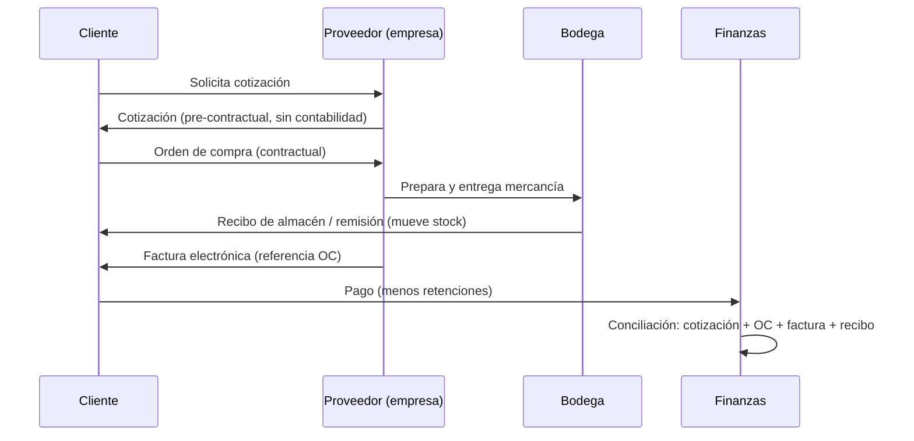
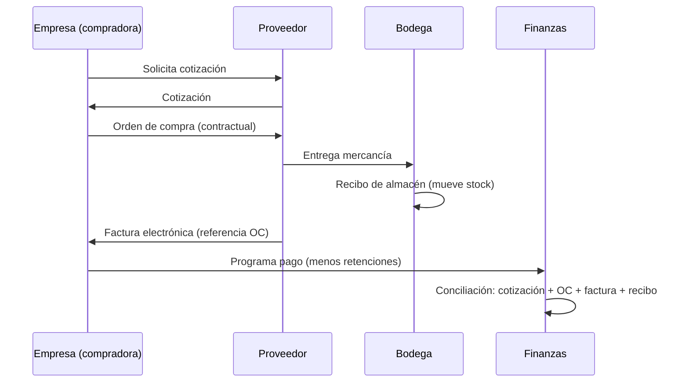

# Ciclo Documental Comercial: Cotización, Orden de Compra y Factura

> Documento de diseño funcional y contable para la aplicación de inventario, cotizaciones, facturación y finanzas.
> Describe el ciclo documental, el tratamiento del IVA (opción B: empresa responsable de IVA) y el mapeo con el estado actual del sistema.

---

## 1. Resumen ejecutivo

La operación comercial no es un solo documento: es una cadena de soportes con funciones distintas.

| Documento | Fase | Emisor → Receptor | ¿Obliga a pagar? | ¿Genera contabilidad? |
|---|---|---|---|---|
| **Cotización** | Pre-contractual | Proveedor → Cliente | No | No |
| **Orden de compra** | Contractual | Comprador → Proveedor | Sí (compromiso) | No (opcional: compromiso presupuestal) |
| **Factura** | Legal / tributaria | Proveedor → Comprador | Sí (título valor) | **Sí** |
| **Recibo de almacén** | Logística | Bodega / receptor | No | No (solo mueve stock) |

**Regla central:** la cotización propone, la orden de compra compromete, la factura legaliza y el recibo de almacén evidencia la entrega física. La contabilidad se reconoce con la **factura**, no con la cotización.

---

## 2. Glosario

- **Cotización:** propuesta comercial de precios, especificaciones, impuestos, tiempos de entrega y vigencia. No genera obligación ni registro contable.
- **Orden de compra (OC):** documento del comprador que acepta la cotización y autoriza el pedido. Es un compromiso contractual.
- **Factura electrónica:** documento legal y tributario que perfecciona la transacción, solicita el pago y sirve de título valor. Debe referenciar la OC cuando exista.
- **Recibo de almacén:** soporte de la entrega/recepción física de los bienes. Es la evidencia logística para conciliar cantidades.
- **Base gravable:** valor sobre el que se calcula el IVA (subtotal menos descuentos).
- **IVA por pagar:** impuesto recaudado en la venta que la empresa debe declarar y pagar (pasivo).
- **IVA descontable:** impuesto pagado en la compra que la empresa puede descontar en su declaración (activo).
- **Retención:** impuesto que el comprador retiene al proveedor y declara/paga por él. No es ingreso ni gasto: es una cuenta por cobrar (proveedor) o por pagar (comprador).
- **Conciliación:** cruce de cotización + orden de compra + factura + recibo de almacén antes de programar el pago.

---

## 3. Los documentos y su naturaleza

### 3.1 Cotización (fase pre-contractual)

- **Propósito:** informar precios, especificaciones, impuestos, tiempos y vigencia.
- **Efecto jurídico:** ninguno; es una invitación a contratar.
- **Efecto financiero:** ninguno.
- **Efecto contable:** ninguno.
- **Datos mínimos:** cliente, fecha de validez, líneas (producto, cantidad, precio unitario, descuento, impuesto), subtotal, descuento, IVA, total, condiciones de pago.
- **Estados sugeridos:** borrador → enviada → aprobada / rechazada → vencida.

### 3.2 Orden de compra (fase contractual)

- **Propósito:** formalizar y autorizar el pedido aceptado.
- **Dirección:** comprador → proveedor.
- **Efecto jurídico:** compromiso vinculante de recibir y pagar bajo las condiciones pactadas.
- **Efecto financiero:** compromiso; opcionalmente reserva presupuesto.
- **Efecto contable:** ninguno (no es una obligación contable todavía; es un compromiso).
- **Datos mínimos:** número de OC, proveedor, referencia a la cotización, líneas, cantidades, precios, impuestos, condiciones de pago, firma/aprobación.
- **Estados sugeridos:** borrador → emitida → recibida parcial / recibida total → cerrada / anulada.

### 3.3 Factura electrónica (fase de cobro y legalización)

- **Propósito:** perfeccionar la transacción, solicitar el pago y cumplir la obligación tributaria.
- **Efecto jurídico:** título valor; obliga al pago.
- **Efecto financiero:** reconoce ingreso/gasto, IVA, costo de ventas y cuentas por cobrar/pagar.
- **Efecto contable:** **sí**, es el documento que dispara la contabilidad.
- **Datos mínimos:** número de factura, fecha, cliente/proveedor, referencia a cotización y orden de compra, líneas, subtotal, descuentos, IVA, retenciones, total, fecha de vencimiento, forma de pago.
- **Estados sugeridos:** borrador → confirmada → anulada.

### 3.4 Recibo de almacén (fase logística)

- **Propósito:** evidenciar la entrega o recepción física de los bienes.
- **Efecto jurídico/financiero:** ninguno por sí mismo.
- **Efecto contable:** ninguno.
- **Efecto logístico:** mueve stock (entrada o salida).
- **Datos mínimos:** número, fecha, factura/OC asociada, producto, cantidad, bodega, responsable.

---

## 4. Flujo completo

### 4.1 Ciclo de venta



### 4.2 Ciclo de compra



---

## 5. Caso práctico

**Comprador:** TechSoluciones.
**Proveedor:** EquiposPlus.

| Paso | Documento | Detalle | Valor |
|---|---|---|---:|
| 1 | Cotización **COT-450** | 5 computadores portátiles Core i7 a $3.000.000 c/u | Subtotal: $15.000.000 |
| | | IVA 19 % | $2.850.000 |
| | | **Total** | **$17.850.000** |
| | | Vigencia 15 días; pago a crédito 30 días | |
| 2 | Orden de compra **OC-882** | “Compra de 5 computadores según cotización COT-450” | Autoriza el pedido |
| 3 | Factura electrónica **FE-9901** | Referencia la OC-882; mismos ítems, precios e impuestos | Total: $17.850.000 |
| | | Vencimiento: 30 días calendario | |
| 4 | Recibo de almacén | Evidencia la entrega/recepción de los 5 equipos | Mueve stock |

**Conclusión:** contabilidad concilia los cuatro soportes. Si cantidades, precios, impuestos y códigos coinciden, se programa el desembolso.

---

## 6. Tratamiento contable con IVA (Opción B)

> Decisión tomada: la empresa **es responsable de IVA**, por lo tanto el IVA se registra por separado como pasivo (venta) o activo (compra). No se mezcla con el ingreso ni con el gasto.

### 6.1 Fórmulas

Para cada línea:

```text
base_linea       = cantidad × precio_unitario
descuento_linea  = base_linea × descuento_pct / 100
base_neta        = base_linea - descuento_linea
iva_linea        = base_neta × impuesto_pct / 100
total_linea      = base_neta + iva_linea
```

Para la factura:

```text
base_neta_total  = Σ base_neta
iva_total        = Σ iva_linea
total_factura    = base_neta_total + iva_total
```

### 6.2 Factura de venta

| Concepto | Registro | Naturaleza | ¿Afecta caja? |
|---|---|---|---|
| Ingreso neto | `Ventas` | Ingreso | No (hasta el pago) |
| IVA recaudado | `IVA por pagar` | Pasivo | No (hasta declarar/pagar) |
| Costo de ventas | `Costo de ventas` | Gasto | No |
| Total por cobrar | `Cuentas por cobrar` | Activo | No (hasta el cobro) |
| Retenciones | `Retención en la fuente / IVA / ICA` | Activo (a favor) | No |

**Ejemplo:** base neta $7.680.000, IVA $1.459.200, total $9.139.200, costo de ventas $7.100.000.

```text
Ingreso Ventas          +7.680.000
IVA por pagar            1.459.200   (pasivo)
Costo de ventas         -7.100.000   (gasto)
Utilidad bruta             580.000
Cuenta por cobrar        9.139.200   (activo)
```

### 6.3 Factura de compra

| Concepto | Registro | Naturaleza | ¿Afecta caja? |
|---|---|---|---|
| Compra neta | `Inventario` | Activo | Sí (salida de caja al confirmar la compra) |
| IVA pagado | `IVA descontable` | Activo | No (se descuenta en la declaración) |
| Total por pagar | `Cuentas por pagar` | Pasivo | No (hasta el pago) |
| Retenciones practicadas | `Retenciones por pagar` | Pasivo | No |

**Ejemplo:** compra neta $10.000.000, IVA $1.900.000, total $11.900.000.

```text
Inventario             +10.000.000   (activo; el gasto se reconoce al vender)
IVA descontable          1.900.000   (activo)
Cuenta por pagar        11.900.000   (pasivo)
```

### 6.4 Cotización y orden de compra

| Documento | Registro contable |
|---|---|
| Cotización | Ninguno |
| Orden de compra | Ninguno (opcional: compromiso presupuestal, no gasto) |
| Recibo de almacén | Ninguno (solo movimiento de stock) |
| Factura | Sí (ver 6.2 y 6.3) |

### 6.5 Retenciones

- **Proveedor (vendedor):** la retención que le practican es un **activo** (saldo a favor) y reduce el dinero recibido, no el ingreso.
- **Comprador:** la retención que practica es un **pasivo** (debe declararla/pagarla) y no es un gasto.
- **Implementación actual:** al confirmar la factura se generan asientos de retenciones:
  - Venta: `Retenciones a favor` (activo). Fuente e ICA reducen el efectivo recibido; la retención de IVA no mueve caja.
  - Compra: `Retenciones por pagar` (pasivo). Fuente e ICA reducen el efectivo pagado; la retención de IVA no mueve caja.
  - A crédito los asientos se reconocen igual, pero con `afecta_caja = 0`: la caja se mueve al registrar el cobro o el pago.
- **Regla de caja:** el movimiento al confirmar es `base (subtotal − descuento) ± retenciones de fuente/ICA`. El IVA nunca entra en ese cálculo: en venta es `IVA por pagar` (pasivo) y en compra `IVA descontable` (activo).

> **Nota técnica:** el modelo financiero ya soporta las naturalezas `ingreso`, `gasto`, `activo` y `pasivo`. Ver sección 14 para el detalle implementado.

---

## 7. Conciliación de los cuatro soportes

Antes de programar un pago se debe verificar:

| Control | Cotización | Orden de compra | Factura | Recibo de almacén |
|---|---|---|---|---|
| Proveedor | X | X | X | X |
| Productos / códigos | X | X | X | X |
| Cantidades | X | X | X | X |
| Precios unitarios | X | X | X | — |
| Descuentos | X | X | X | — |
| IVA | X | X | X | — |
| Total | X | X | X | — |
| Fecha de entrega | X | X | X | X |
| Condiciones de pago | X | X | X | — |

**Regla:** la factura debe referenciar la OC y coincidir con la cotización aprobada. Cualquier diferencia debe justificarse antes del pago.

---

## 8. Estado actual de la aplicación vs. ciclo objetivo

> Actualizado tras la implementación de la migración `V012__contabilidad_iva_y_trazabilidad.sql`. El detalle está en la sección 14.

### 8.1 Módulos actuales

| Documento del ciclo | Módulo actual | Estado | Observación |
|---|---|---|---|
| Cotización | `quotes` | Implementado | Al entregar solo mueve stock (recibo/remisión); **no genera contabilidad**. |
| Orden de compra | campos `orden_compra` | Implementado (referencia) | Se referencia en la factura; no hay módulo completo. |
| Factura de venta | `invoices` tipo `venta` | Implementado | Asientos de cabecera: ingreso neto, IVA por pagar y costo de ventas. |
| Factura de compra | `invoices` tipo `compra` | Implementado | Asientos de cabecera: activo Inventario neto e IVA descontable; no actualiza `products.costo` (M1). |
| Recibo de almacén | `stock_movements` | Implementado | La entrega de cotización y la factura directa mueven stock; la factura vinculada a una cotización entregada no lo duplica. |
| Presupuesto | `budgets` | Implementado | Líneas por categoría financiera con alcance general, producto o categoría de producto. |

### 8.2 Comportamiento corregido

| Punto | Antes | Ahora |
|---|---|---|
| Cotización entregada | Generaba ingreso + costo de ventas | **No genera contabilidad**; solo salida de stock con origen `entrega`. |
| Factura de venta | Ingreso por línea + ingreso de cabecera | Un solo juego de asientos de cabecera vinculado a la factura. |
| Factura de compra | Gasto por línea sin descuento/IVA + cabecera | Gasto neto (con descuento, sin IVA) + IVA descontable. |
| Anulación de factura | Solo revertía la cabecera | Revierte **todos** los asientos y el stock; restaura el costo si fue compra. |
| Costo de salida | `NULL` / costo actual | Costo histórico guardado en `stock_movements.costo_unitario`. |
| Precio de venta en movimientos | No se guardaba | `stock_movements.precio_unitario`, visible según rol. |
| Vínculo cotización → factura | No existía | `invoices.quote_id` evita doble reconocimiento. |
| Vínculo factura → transacción | No existía | `transactions.invoice_id` + link a `/facturas/:id`. |
| IVA | No se registraba | Pasivo (`IVA por pagar`) o activo (`IVA descontable`). |
| Retenciones | No se manejaban | Campos informativos y `total_neto`. |

---

## 9. Decisiones tomadas y su impacto

### D1. IVA: empresa responsable → Opción B

- El ingreso/gasto se registra **neto** (sin IVA).
- El IVA de venta se registra como **pasivo** (“IVA por pagar”).
- El IVA de compra se registra como **activo** (“IVA descontable”).
- El total de la factura es la suma de neto + IVA.
- **Implicación:** el modelo financiero debe soportar `activo` y `pasivo`, no solo `ingreso`/`gasto`.

### D2. Transacción de cabecera con vínculo a la factura

- Se prefiere **una transacción de cabecera por factura** (o un grupo de asientos de cabecera) y no una transacción por línea.
- El detalle por producto se consulta en **Movimientos**.
- Se agrega `invoice_id` a `transactions` para mostrar un **link a `/facturas/:id`**, igual que se quiere hacer con las cotizaciones.
- **Implicación:** los asientos por línea de los movimientos deben desactivarse para no duplicar. La transacción de cabecera no tiene `product_id`; para presupuestos por producto/categoría se necesita una tabla de distribución (`transaction_allocations`) o calcular la distribución desde `invoice_items`.
- **Pregunta:** ¿la cabecera debe ser una sola fila con el total, o varias filas (neto, IVA, costo de ventas) agrupadas por factura? Contablemente lo correcto es lo segundo; visualmente se pueden agrupar.

### D3. Costo histórico + precio de venta

- `stock_movements.costo_unitario` se guarda en **todas** las salidas (snapshot del costo del producto al salir).
- Se agrega `stock_movements.precio_unitario` (nullable) para las salidas de venta/entrega, tomado de la línea de cotización o factura.
- En Movimientos se muestran dos columnas: **Costo unitario** y **Precio unitario**.
- **Pregunta:** ¿el precio de venta lo pueden ver todos los roles o solo admin/contador? El costo ya está restringido por rol.

### D4. Ciclo documental lógico

- Cotización: pre-contractual, **sin contabilidad**.
- Orden de compra: contractual, **sin contabilidad** (opcional: compromiso presupuestal).
- Factura: legal/tributaria, **dispara la contabilidad**.
- Recibo de almacén: logístico, **solo stock**.
- **Implicación:** la entrega de cotización no debe generar ingreso ni costo de ventas. Hay que definir qué documento mueve el stock.

---

## 10. Modelo técnico propuesto

### 10.1 Cambios de esquema

| Tabla | Cambio | Para qué |
|---|---|---|
| `transactions` | `invoice_id` FK nullable | Vincular el asiento a la factura y mostrar link |
| `transactions` | `tipo` ampliado a `ingreso`, `gasto`, `activo`, `pasivo` **o** campo `naturaleza` | Representar IVA por pagar/descontable y cuentas por cobrar/pagar |
| `transactions` | `transaction_allocations` (nueva tabla) | Distribuir el asiento de cabecera por producto/categoría para presupuestos |
| `stock_movements` | `precio_unitario` nullable | Mostrar el precio de venta en salidas |
| `invoices` | `quote_id` nullable | Vincular factura con cotización y evitar doble ingreso |
| `invoices` | `orden_compra` varchar | Referenciar la OC |
| `invoices` | `subtotal`, `descuento_total`, `impuesto_total` | Guardar el desglose tributario |
| `invoices` | `retencion_fuente`, `retencion_iva`, `retencion_ica`, `total_neto` | Retenciones (opcional según decisión) |
| `budget_lines` | `product_category_id` nullable | Presupuesto por categoría de producto |
| `purchase_orders` | Nueva tabla (opcional) | Módulo de órdenes de compra |

### 10.2 Cambios de servicios

| Servicio | Cambio |
|---|---|
| `registerMovement` | Añadir `skipFinance` para que las llamadas internas (cotización/factura) no creen asientos |
| `confirmInvoice` | Crear asientos de cabecera una sola vez: neto, IVA, costo de ventas (si aplica) |
| `cancelInvoice` | Revertir todos los asientos con `invoice_id` y el stock asociado |
| `deliverQuote` | No generar contabilidad; mover stock solo si se decide que la entrega es el recibo de almacén |
| `getSummary` | Separar estado de resultados (ingreso/gasto) de impuestos (activo/pasivo) |
| `getBudget` | Calcular ejecución por categoría de producto usando `transaction_allocations` o `invoice_items` |
| `finance.service` | CRUD de cuentas con `saldo_inicial` |

### 10.3 Cambios de UI

| Pantalla | Cambio |
|---|---|
| Facturas (formulario) | Mostrar stock disponible; campos de IVA, retenciones, OC y cotización vinculada |
| Facturas (detalle) | Sección “Finanzas” con los asientos vinculados |
| Transacciones | Columna “Documento” con link a la factura (`/facturas/:id`) |
| Movimientos | Columnas “Costo unitario” y “Precio unitario”; filtro por origen |
| Presupuestos | Línea por categoría de producto |
| Cuentas | Crear/editar cuenta con saldo inicial |

---

## 11. Preguntas abiertas (resueltas)

| # | Pregunta | Decisión implementada |
|---|---|---|
| 1 | ¿IVA completo activo/pasivo? | Sí: `IVA por pagar` (pasivo) e `IVA descontable` (activo). |
| 2 | ¿Cabecera una fila o varias? | Varias filas agrupadas por factura (neto, IVA, costo de ventas) con `invoice_id`. |
| 3 | ¿Presupuesto por categoría vía allocations? | Sí: `transaction_allocations` distribuye los asientos de cabecera. |
| 4 | ¿Qué documento mueve stock? | La entrega de cotización mueve stock sin finanzas; la factura directa mueve stock y contabiliza; si la cotización ya se entregó, la factura solo contabiliza. |
| 5 | ¿Módulo de órdenes de compra? | Solo campo de referencia `orden_compra` en la factura. |
| 6 | ¿Retenciones? | Campos informativos; reducen `total_neto`, no generan asientos. |
| 7 | ¿Precio de venta visible para todos? | Restringido con `canSeeCosts` (todos menos `operador`). |
| 8 | ¿Cotización → factura? | Se vincula con `quote_id` y se evita el doble reconocimiento. |
| 9 | ¿Editar saldo inicial con transacciones? | Se permite, queda auditado como ajuste de saldo. |
| 10 | ¿Capital del periodo o histórico? | Saldo histórico de caja/bancos de cuentas activas; el IVA no lo afecta. |

---

## 12. Plan de implementación por fases

| Fase | Alcance | Dependencias |
|---|---|---|
| **F1. Consistencia financiera** | `skipFinance`, una sola fuente de asientos por factura, `invoice_id`, anulación completa | D2 |
| **F2. IVA opción B** | Desglose de impuestos, cuentas activo/pasivo, resumen separado | D1 |
| **F3. Costos y precios en movimientos** | Costo histórico en salidas, precio de venta, columnas UI | D3 |
| **F4. Ciclo documental** | Cotización sin contabilidad, definir dueño del stock, OC (según decisión) | D4 |
| **F5. Presupuestos analíticos** | Categoría de producto, distribuciones, ejecución | F1 |
| **F6. Cuentas y capital** | CRUD de cuentas, saldo inicial, definición de capital | — |
| **F7. UX facturación** | Stock en formulario, links a factura, ayudas contextuales | F1 |

---

## 13. Criterios de aceptación globales

- Una cotización **no** genera transacciones financieras.
- Una factura confirmada genera **un solo juego de asientos** (sin duplicados por línea).
- El total de asientos de una factura cuadra con su desglose: neto + IVA = total.
- Anular una factura revierte **todos** sus asientos y su stock.
- El costo de ventas usa el **costo histórico** al momento de la salida.
- El precio de venta se conserva separado del costo.
- Una transacción muestra el vínculo a su factura.
- Un presupuesto por categoría de producto calcula su ejecución sin dobles conteos.
- Una cuenta muestra saldo inicial + ingresos − egresos.
- No se reconoce dos veces el mismo ingreso entre cotización y factura.

---

## 14. Implementación realizada

### 14.1 Base de datos (`V012__contabilidad_iva_y_trazabilidad.sql`)

- `finance_categories.tipo` y `transactions.tipo` ampliados a `ingreso`, `gasto`, `activo`, `pasivo`.
- Categorías contables `IVA por pagar` (pasivo) e `IVA descontable` (activo).
- `transactions.invoice_id`; `stock_movements.precio_unitario`, `invoice_id`, `quote_id`, `origen`.
- `invoices`: `quote_id`, `orden_compra`, `subtotal`, `descuento_total`, `impuesto_total`, retenciones y `total_neto`.
- `invoice_items.costo_anterior` para restaurar el costo al anular una compra.
- `transaction_allocations` para distribuir asientos de cabecera por producto/categoría.
- `budget_lines.product_category_id` + `scope_key` único por alcance.

### 14.2 Servicios

- `registerMovement` acepta `skipFinance`, `invoiceId`, `quoteId` y `precio_unitario`; guarda costo histórico en salidas.
- `deliverQuote` mueve stock sin crear asientos.
- `confirmInvoice` crea asientos de cabecera (neto, IVA, costo de ventas), distribuciones y stock según corresponda.
- `cancelInvoice` revierte todos los asientos con contrapartidas, el stock y restaura el costo.
- `getSummary` expone `iva_por_pagar` e `iva_descontable`; el capital solo considera ingresos/gastos.
- `finance.service` incluye CRUD de cuentas con `saldo_inicial` y auditoría.
- `budgets.service` calcula la ejecución vía `transaction_allocations` y resuelve disponibilidad producto > categoría > general.

### 14.3 UI

- Formulario de factura: cotización vinculada, orden de compra, retenciones, IVA, total neto y stock en el selector de producto.
- Detalle de factura: desglose tributario, link a cotización y tabla de asientos financieros.
- Transacciones: naturalezas IVA, columna Documento con link a la factura y bloqueo de anulación de asientos automáticos.
- Movimientos: costo histórico, precio unitario, origen y links a factura/cotización.
- Presupuestos: alcance general, producto o categoría de producto.
- Finanzas: tarjetas de IVA por pagar/descontable y CRUD de cuentas con saldo inicial.

---

*Implementación completada sobre la rama `feat/base-financiera`. Los tests del servidor y el build del cliente deben permanecer en verde.*

> **Siguiente iteración:** ver `docs/MEJORAS-FACTURACION-CONTABILIDAD.md` para el backlog de costeo, costo de ventas vs capital, alertas de stock, IVA/retenciones automáticas, aprobación con stock y autocompletado de facturas desde cotización.
